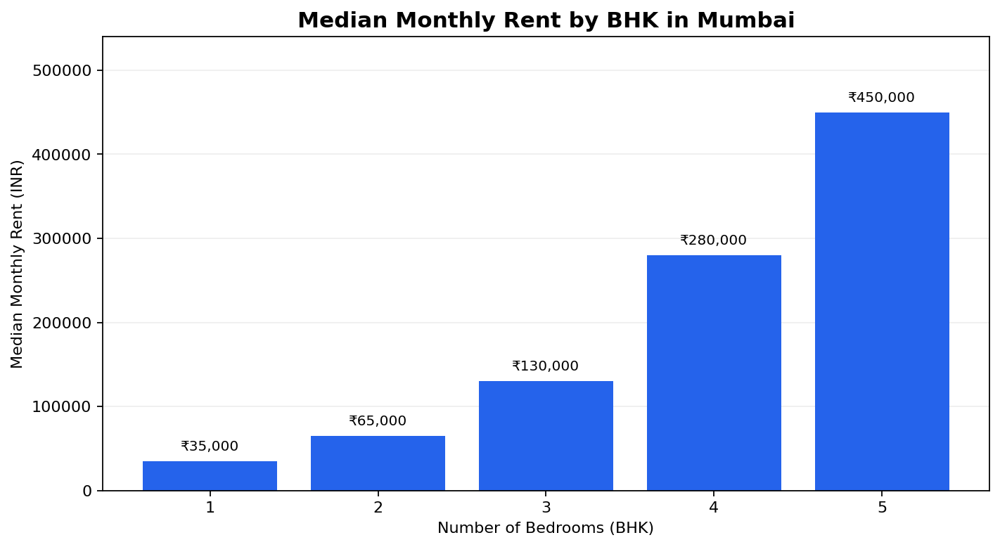
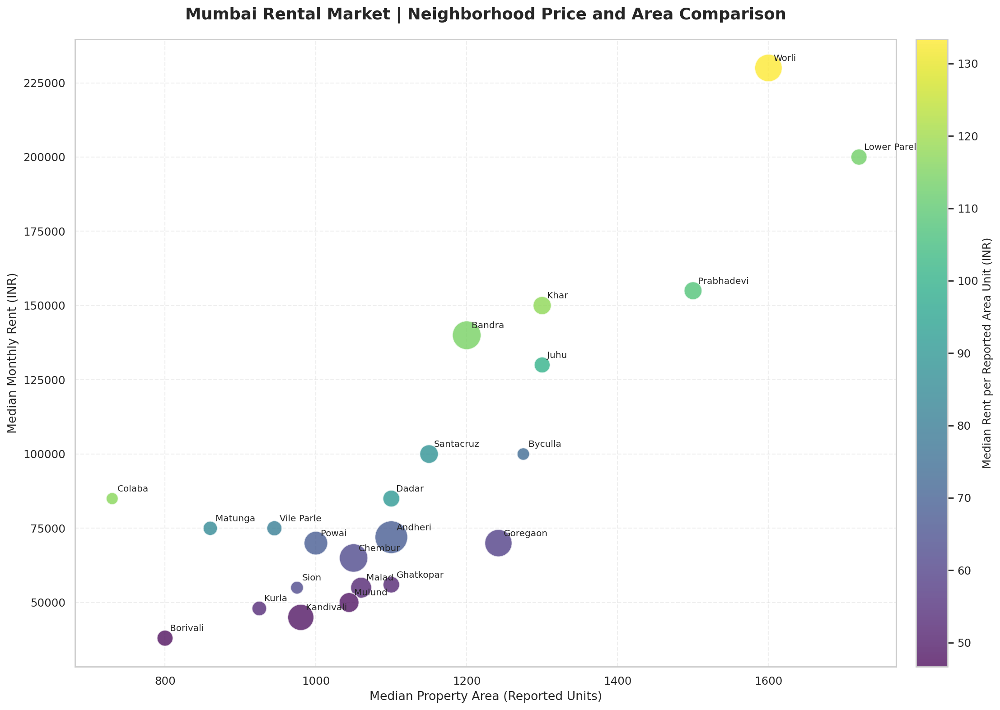
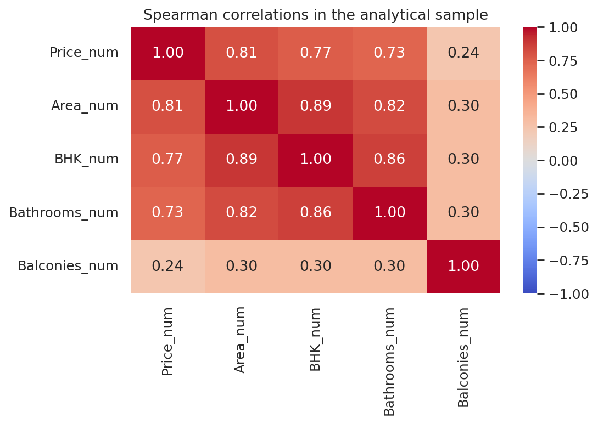

# Mumbai Rental Property Data Analysis

**IAAC MaAI — AI Methods I, Day 1 | Group 3**

**Team:** Ahmed Belahcen, Nandini Rathod, Sanjana Kiran, Akanksha Dhumal.

## Use case
How do dwelling size, furnishing and neighbourhood relate to advertised rents in Mumbai? We compare housing types and investigate whether rent differences persist when expressed per reported area unit. This supports residential market exploration, not causal valuation or household affordability estimates.

## Dataset
- Source: [Property Rental Listings Dataset](https://www.kaggle.com/datasets/harshalhonde/property-rental-listings-dataset), Harshal H (`harshalhonde`).
- Raw file: `Mumbai_property_details.csv`, 23,405 rows and 18 columns. One row is an advertised listing, not necessarily a unique dwelling.
- Data licence: [CC BY 4.0](https://creativecommons.org/licenses/by/4.0/), verified directly on the [Kaggle data card](https://www.kaggle.com/datasets/harshalhonde/property-rental-listings-dataset) on 15 November 2026. Credit: Harshal H; original listing source: Magicbricks.
- Modifications: team precleaning, numeric parsing, analytical filtering, category standardization and rent-per-area features.

The notebook downloads missing raw inputs and retrieves the historical precleaned input from fixed revision `ccbcf01c14ee3f0ed8273d6df5cbcd75e405e6a6`, checking its SHA-256. The original precleaning is represented by this input and its audit; it is **not regenerated from raw records**. Subsequent analysis is reproducible from that historical input. First-run downloads require internet access.

## Files
| Path | Purpose |
|---|---|
| `notebook/final_analysis.ipynb` | Main notebook with executed outputs |
| `data/mumbai_rentals_cleaned.csv` | Single final analytical dataset, exported by the notebook |
| `data/raw/` | Ignored downloaded inputs |
| `figures/` | Exported PNG charts |
| `reports/cleaning_audit.csv` | Historical audit, not another analytical dataset |
| `requirements.txt` | Five direct dependencies, pinned and UTF-8 encoded |
| `LICENSE` | MIT licence for code |

## How to run
Use Python 3.12. From the repository root:

```powershell
python -m venv .venv
.venv\Scripts\Activate.ps1
python -m pip install -r requirements.txt
python -m pip install ipykernel==6.28.0
```

On macOS/Linux activate with `source .venv/bin/activate`. Open `notebook/final_analysis.ipynb` in VS Code with the Jupyter extension, select `.venv`, restart the kernel and run all cells. The notebook supports execution from its folder or the repository root. It exports the final CSV and charts. `ipykernel` is installed separately as notebook tooling.

## Data quality
| Check | Treatment and limitation |
|---|---|
| Missing values and duplicates | Counts displayed before and after filtering; unknown balconies retained as missing |
| Numeric fields | Explicit parsing; unusable or nonpositive rent/area excluded |
| Configuration | BHK outside 1–5 and unusually large bathroom/balcony counts excluded under project-specific scope assumptions |
| Area and rent outliers | Inspected and documented; unusual values are not automatically proof of errors |
| Categories | Furnishing and orientation standardized before comparison |
| Geographic coverage | Neighbourhoods inferred from titles; minimum sample counts used for grouped plots |

Some intermediate cells explore alternative filtering rules before explicitly rebuilding the final sample. Use only the CSV exported at the end for later assignments.

## Key findings
- The original final analytical sample contains 18,846 listings versus 23,405 raw records; filtering narrows the housing market represented.
- Median rent is INR 70,000/month (mean INR 111,498); the middle 50% ranges from INR 45,000 to INR 130,000.
- Median rents rise from INR 35,000 for 1 BHK to INR 65,000 for 2 BHK and INR 130,000 for 3 BHK.
- Spearman correlation between reported area and rent is 0.81; this is association, not a causal estimate.
- Missing balcony and construction-year values limit analysis. Exact counts and numerical summaries appear in the notebook's final quality report.
- Correlation describes association, not causation: building quality, micro-location and listing selection may confound results.







## Limitations and modelling
Listing dates, repeated listings, uncertain area units, title-based locations and omitted building attributes limit interpretation. This is not a representative market survey. Minimum group sizes do not establish statistical significance. The historical precleaning is not independently reproduced from raw records here.

A future target is `Price_num`. Exclude `Price`, `Rent_per_Area` and rent-derived flags or thresholds from model predictors to avoid leakage. Fit imputation and encoding on training data only.

## AI usage disclosure
| Question | Disclosure |
|---|---|
| Tools | ChatGPT/Codex as a coding agent for this correction |
| Why | Address instructor feedback, repair reproducibility and document results |
| Where | Dependencies, cell ordering, figures, statistics, correlation, CSV export and README |
| How | The user supplied the issue. The agent inspected GitHub and an unfinished local correction, executed cells sequentially in a fresh Python process, and fixed an undefined furnishing-analysis variable caused by incorrect cell order. |
| Lessons learned | Saved outputs can conceal execution-order errors. Run from a clean process, export files explicitly and distinguish historical precleaning from reproducible analysis. |

This describes the observed correction workflow. The available record does not establish which additional tools, if any, were used by other contributors during the original assignment; no claim is made about unobserved usage. The team remains responsible for reviewing the decisions and interpretations.

## License
Code: [MIT](LICENSE). Data: separately attributed to Harshal H under the provenance above; the code licence does not relicense the dataset.

## Reproducibility verification
[GitHub Actions run 43698931201](https://github.com/iaac-maai/Group3-day1assignment/actions/runs/43698931201) passed on 15 November 2026. In a fresh Python 3.12 environment it installed `requirements.txt`, passed `pip check`, downloaded both inputs, and executed all **57 code cells** in a new Jupyter kernel without errors. The executed notebook, 21 PNG figures and 18,846-row CSV from that verified run are committed here. The workflow repeats these checks on subsequent pushes and pull requests.
